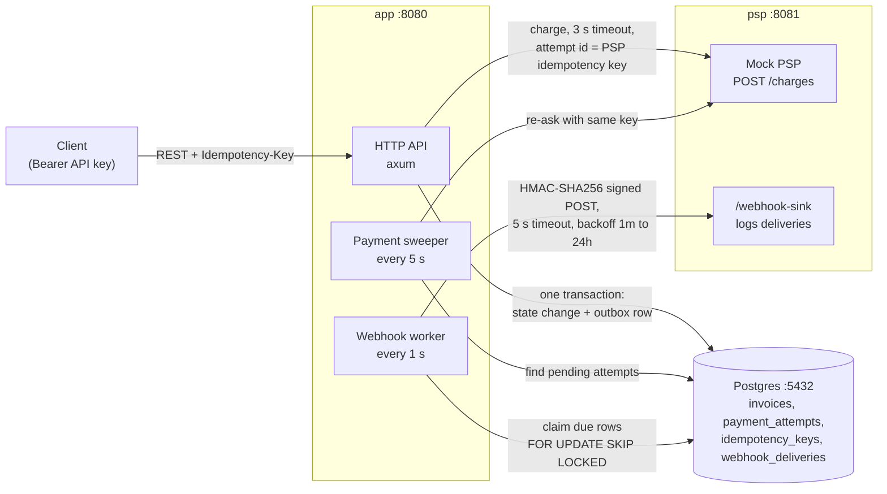

# Architecture

Three containers (`docker compose up`). The `app` runs the API and two background workers; the
`psp` container runs the mock PSP and the demo webhook sink. Details and trade-offs: [`DESIGN.md`](DESIGN.md).

## Services

- The API never waits on webhooks: it only writes an outbox row in the same transaction as the change.
- The PSP is called over HTTP like a real external service. No answer means "unknown", never "failed".
