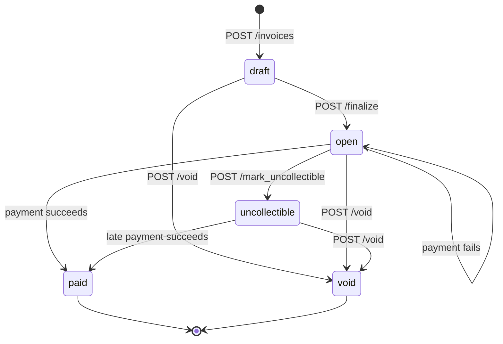

# Design

Service diagram: [`ARCHITECTURE.md`](ARCHITECTURE.md).

## 1. Data Model

```text
businesses ─┬─< api_keys
            ├─< customers ─< invoices ─┬─< line_items
            ├─< invoices               └─< payment_attempts
            ├─< idempotency_keys
            └─< webhook_endpoints ─< webhook_deliveries
```

| Table | Key columns | Indexes / constraints | Why this shape |
|---|---|---|---|
| `businesses` | `id`, `name` | PK | The tenant. Everything hangs off it. |
| `api_keys` | `business_id`, `prefix`, `key_hash`, `revoked_at` | `key_hash` UNIQUE | Only a hash is stored (§5). Several keys per business allow rotation. |
| `customers` | `business_id`, `name`, `email` | `(business_id, created_at DESC)`; UNIQUE `(business_id, id)` | Email is **not** unique: two customers can share a billing address. |
| `invoices` | `business_id`, `customer_id`, `status`, `total_cents`, `currency`, `due_date` | FK `(business_id, customer_id)` → customers; `(business_id, status, created_at DESC)` | The composite FK means the **database** refuses an invoice pointing at another business's customer. |
| `line_items` | `invoice_id`, `position`, `quantity`, `unit_amount_cents`, `amount_cents` | UNIQUE `(invoice_id, position)` | `amount_cents` is a generated column, so it can't disagree with quantity × price. |
| `payment_attempts` | `invoice_id`, `status`, `amount_cents`, `psp_ref`, `failure_code` | **partial UNIQUE `(invoice_id) WHERE status IN ('pending','succeeded')`**; partial index on pending | One row per try. The partial unique index is the double-charge guard (§3). |
| `idempotency_keys` | PK `(business_id, key)`, `request_hash`, `response_status`, `response_body` | PK | `response` NULL = still running. Per business, so tenants can't collide. |
| `webhook_endpoints` / `webhook_deliveries` | see §4 | partial index on due deliveries | Outbox written in the same transaction as the change. |

**Choices that apply everywhere:**

- **Money:** `BIGINT` cents with `CHECK`s (`quantity > 0`, `total_cents > 0`, `amount_cents > 0`),
  `i64` in Rust, overflow-checked math. No floats; `NUMERIC` would add a decimal type for no gain.
- **Primary keys:** UUID v4, generated by the app. Unguessable, and known before insert, which
  matters because the attempt id doubles as the PSP idempotency key (§3c).
- **States:** `TEXT` + `CHECK`, not Postgres `ENUM` (enums are awkward to change in migrations).
- **"Payment in flight" lives on the attempt, not the invoice.** There is no invoice `processing`
  state, so a PSP timeout never leaves the invoice half-changed: it stays `open`.

**At 100x scale:** UUID v7 for index locality; cursor pagination (today: newest 100) plus a
`(business_id, created_at)` index for the unfiltered invoice list; expire idempotency keys after
24 h; prune or partition `webhook_deliveries` by `created_at`.

## 2. Invoice State Machine



- **Terminal:** `paid` and `void`. Undoing `paid` would need refunds (cut).
- **Reversible:** only `uncollectible`. A written-off bill can still be paid late, or voided.
- **Payable:** `open` and `uncollectible`. A `draft` must be finalized first. Drafts aren't
  editable: void and recreate.
- **How invalid moves are rejected:** the whole table is one function, `next_status(state, action)`
  in `src/invoices.rs`. Anything it doesn't list returns **409 `invalid_state_transition`**
  ("cannot finalize an invoice in state 'void'"). A unit test checks every state × action pair.
- **Every change locks the invoice row first** (`SELECT … FOR UPDATE`), so concurrent changes run
  one after the other and the second sees the new state.
- **Void / mark uncollectible are blocked while a payment is pending** (409 `payment_in_progress`):
  that payment could still succeed, charging for a cancelled bill.

## 3. Payment Correctness & Failure Modes

**The flow of `POST /invoices/{id}/pay`:**

1. Claim the `Idempotency-Key` (insert into `idempotency_keys`; only one request can win).
2. One transaction: lock the invoice (`FOR UPDATE`), check it's payable, insert a `pending`
   attempt, **commit**. No lock is held while we wait on the PSP.
3. Call the PSP with the attempt id as **its** idempotency key. Timeout: 3 s.
4. Settle: one transaction updates the attempt, the invoice and the webhook outbox together.
5. Save the response on the idempotency key for replays.

**Core rule: no answer from the PSP means "unknown", never "failed".** A timeout, dropped
connection, 5xx or garbled reply means money may have moved. The attempt stays `pending`, and a
background **sweeper** asks the PSP again (same key) until it gets a definite answer.

### (a) Two `/pay` calls on the same invoice at the same instant

Exactly one charges; the other gets **409**. Both try to lock the invoice row and the second waits.
It then hits the **partial unique index** (one `pending`/`succeeded` attempt per invoice) →
**409 `payment_in_progress`**, or, if the first already succeeded, the invoice is `paid` →
**409 `invalid_state_transition`**.

**Mechanism:** a row-level lock to queue requests, backed by a database constraint that makes a
second live attempt impossible even if some code path forgot the lock. Optimistic concurrency
would need client retries; serializable isolation would abort whole transactions for the same result.

Tested: `concurrent_pays_charge_once` fires 10 concurrent calls → one 200, PSP charged once.

### (b) The PSP times out (`tok_timeout`, 30 s)

- After 3 s `/pay` returns **202** with the attempt `pending`; the invoice stays `open`.
- The sweeper (every 5 s) re-asks with the same key. While the PSP is still working it answers
  `409 processing` (still unknown); once the charge finishes it returns the stored success →
  attempt `succeeded`, invoice `paid`, `invoice.paid` sent.
- **How the caller finds out:** the `invoice.paid` / `invoice.payment_failed` webhook, or `GET /invoices/{id}`.
- While pending, a new `/pay` or a void → 409. Nothing can double-charge or cancel a bill about to be paid.
- After 10 min without an answer we log an alert and keep retrying once a minute. Giving up would
  leave the invoice stuck with no way to fix it.
- Exception: if the very **first** connection is refused, no bytes reached the PSP, so nothing was
  charged → attempt `failed`, **503 `psp_unavailable`**, safe to retry.

Tested: `psp_timeout_does_not_leave_invoice_stuck`.

### (c) The PSP charges, then our service crashes before saving it

No double charge. The `pending` attempt was committed **before** the PSP call, so it survives the
crash. After restart the sweeper re-asks with the same key (the attempt id); the PSP returns the
original success instead of charging again, and the attempt and invoice settle normally. A client
retrying meanwhile gets 409 (`payment_in_progress`, or `request_in_progress` for the same key).
`tok_network_error` simulates this: the PSP charges, then drops the connection.

Gaps: an idempotency key claimed just before the crash stays "in progress" forever (fix: treat
in-flight keys older than ~1 min as abandoned). The mock PSP keeps keys in memory, so this relies on
the real PSP persisting them (§6).

### (d) Same idempotency key, different request body

**422 `idempotency_key_reused`**, no PSP call. We hash what the request *means* (invoice id + card
token), not the raw bytes, so formatting differences don't matter. The saved response is untouched.

### (e) `/pay` on an invoice that is already `paid`

**409 `invalid_state_transition`**; the PSP is never called. The *same* key as the successful
payment replays the original **200** instead: same request, same response.

## 4. Webhook Design

**Events:** `invoice.created`, `invoice.finalized`, `invoice.voided`, `invoice.marked_uncollectible`,
`invoice.paid`, `invoice.payment_failed`. Invoices start as `draft`, so "created" and "now owed"
are different moments; I send both (like Stripe). Payload: `{id, type, created_at, data: <invoice>}`;
`id` is the same for every endpoint so receivers can drop duplicates. Endpoints are registered with
`POST /webhook_endpoints`; the `secret` is shown only once.

### Signing

```text
Dodo-Signature: t=<unix seconds>,v1=<hex HMAC-SHA256(secret, "<t>.<raw body>")>
```

- **Algorithm:** HMAC-SHA256 with the endpoint's secret (Stripe's scheme).
- **What is signed:** timestamp + `.` + the exact body bytes.
- **Replay protection:** the timestamp is signed, so receivers reject anything older than 5 minutes
  and drop event `id`s they've seen.
- The secret is stored in plain text because signing needs it (encryption at rest: §7).

### Delivery and retries

A worker inside the app checks the outbox every second:

1. **Claim** up to 10 due rows by pushing their next try 30 s ahead (a lease, `FOR UPDATE SKIP LOCKED`).
   No transaction is open during HTTP, two app instances never send the same row, and a crash
   mid-send just makes the row due again.
2. **Send** concurrently, each with a **5 s timeout**, so one slow receiver can't block the rest.
3. **Record:** `2xx` → `delivered`; anything else → save the error, schedule the next try.

| Attempt | 1 | 2 | 3 | 4 | 5 | 6 | 7 | 8 |
|---|---|---|---|---|---|---|---|---|
| After previous failure | immediately | 1 min | 5 min | 30 min | 2 h | 6 h | 12 h | 24 h |

**Budget:** 8 attempts over ~45 hours, enough to survive a receiver down overnight.
Delivery is **at-least-once, possibly out of order**: receivers dedupe on `id`, and each event
carries the invoice's `updated_at` so older events can be ignored.

**When retries run out:** the row is marked `failed` with its `last_error`, and a warning is logged.
No automatic redelivery (§6).

**Reconciling missed events:** the invoice is the source of truth, not the webhooks.
`GET /invoices?status=paid` (or any status) and compare with your records.

**Why decoupled:** the API only **writes** an outbox row in the **same transaction** as the invoice
change, so an event can't be lost or sent for a change that didn't happen. The worker sends it
later, so a slow or broken receiver never slows or fails an API call.
Code: `src/events.rs` (outbox write), `src/webhooks.rs` (worker).

## 5. API Key Model

- **Generation:** keys look like `sk_test_…`. There is no key-creation endpoint (cut, §6); the only
  key is created at startup (below). A real one would be 32 random bytes from the OS RNG, base62-encoded.
- **Storage:** SHA-256 of the key, plus the first 12 characters as `prefix` so a human can tell keys
  apart in logs and support. No plaintext. A fast hash is fine here: keys are long random strings,
  not passwords, so there is nothing to brute-force, and lookup stays one indexed query.
- **Transmission:** `Authorization: Bearer <key>`, over TLS in production. Never in URLs (which end up in logs).
- **Rotation:** a business can hold several active keys, so a new key can go live before the old one is revoked.
- **Revocation:** set `revoked_at`. Every request checks it in the database (no cache), so revocation
  is immediate. No API for it yet (§6).
- **Blast radius if leaked:** full read/write on **one** business: its customers, invoices and
  payments, using card tokens the attacker would also need. Every query is scoped by `business_id`,
  and the composite FKs stop cross-tenant references, so other businesses are unaffected.
  No per-key scopes (e.g. read-only); I'd add them before production.

**Bootstrapping:** with hashed keys and no signup, a fresh database has no way in. If
`SEED_API_KEY` is set, startup creates a "Demo Business" owning that key (idempotent;
`ensure_business_with_key` in `src/auth.rs`). An admin endpoint would add a manual step and a
second auth system. The demo key is public, so a real deployment wouldn't set it.

## 6. What I Cut and Why

- **Business signup and key management endpoints.** Replaced by the startup seed (§5). Building
  them means a second auth mechanism for features outside the must-have list.
- **Per-state timestamps on invoices (`finalized_at`, `paid_at`, `voided_at`).** Today only
  `created_at` and `updated_at` exist, so "when was this paid?" can't be answered from the invoice.
  A real system needs them (days overdue, reporting, dates on the bill), each set once in its
  transition's transaction. Skipped because nothing in the assignment reads them. `webhook_deliveries`
  is not a substitute: it only has rows if an endpoint is registered, duplicates per endpoint, and gets pruned.
- **Persistent storage for the mock PSP.** It keeps idempotency keys in memory; a real PSP persists
  them, and my service relies on that. So only a mock restart between charge and retry could
  double-charge, which no graded case does. A database for a mock would test nothing new.
- **Webhook redelivery and endpoint management.** No resend, delete/disable or secret rotation
  endpoints. `GET /invoices` covers reconciliation; the `disabled_at` column already exists.
- **A separate webhook receiver for the demo.** The mock PSP's `/webhook-sink` route logs what it
  receives. Both are "the fake outside world", so a third container would add nothing.

## 7. Production Readiness Gap

- **Audit log.** No permanent record of who changed an invoice and when. I'd add an append-only
  `invoice_events` table (invoice, from → to, action, API key, timestamp), written in the same
  transaction as the change, and create webhook deliveries from it so notifications and history
  can't disagree. Covers support ("who voided this?") and compliance.
- **Webhook URL safety (SSRF).** Any `http(s)` URL is accepted, including internal addresses and
  the cloud metadata IP. I'd resolve the host, reject private, loopback and link-local IPs, and require `https`.
- **Webhook secrets encrypted at rest**, with a key held outside the database (KMS).
