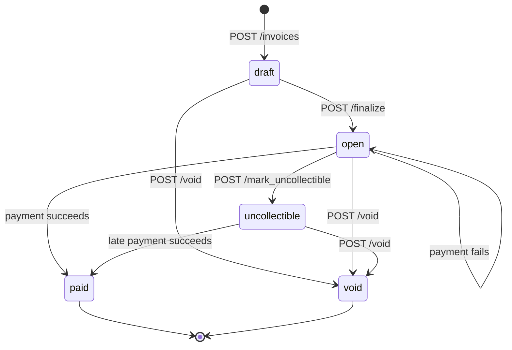

# Design

## 1. Data Model

```
businesses ─┬─< api_keys
            ├─< customers ─< invoices ─┬─< line_items
            ├─< invoices               └─< payment_attempts
            ├─< idempotency_keys
            └─< webhook_endpoints ─< webhook_deliveries
```

| Table | Key columns | Indexes / constraints | Why this shape |
|---|---|---|---|
| `businesses` | `id`, `name` | PK | The tenant. Everything else hangs off it. |
| `api_keys` | `business_id`, `prefix`, `key_hash`, `revoked_at` | `key_hash` UNIQUE | Only a hash is stored (§5). Several keys per business allow rotation. |
| `customers` | `business_id`, `name`, `email` | `(business_id, created_at DESC)`; UNIQUE `(business_id, id)` | Email is **not** unique: two customers can share a billing address. |
| `invoices` | `business_id`, `customer_id`, `status`, `total_cents`, `currency`, `due_date` | FK `(business_id, customer_id)` → customers; `(business_id, status, created_at DESC)` | The composite FK means the **database** refuses an invoice pointing at another business's customer. |
| `line_items` | `invoice_id`, `position`, `quantity`, `unit_amount_cents`, `amount_cents` | UNIQUE `(invoice_id, position)` | `amount_cents` is a generated column, so it can't disagree with quantity × price. |
| `payment_attempts` | `invoice_id`, `status`, `amount_cents`, `psp_ref`, `failure_code` | **partial UNIQUE `(invoice_id) WHERE status IN ('pending','succeeded')`**; partial index on pending | One row per try. The partial unique index is the double-charge guard (§3). |
| `idempotency_keys` | PK `(business_id, key)`, `request_hash`, `response_status`, `response_body` | PK | `response` NULL = still running. Keys are per business, so tenants can't collide. |
| `webhook_endpoints` / `webhook_deliveries` | see §4 | partial index on due deliveries | Outbox written in the same transaction as the change. |

**Choices that apply everywhere:**
- **Money:** `BIGINT` cents with `CHECK`s (`quantity > 0`, `total_cents > 0`, `amount_cents > 0`),
  `i64` in Rust, overflow-checked math. No floats; `NUMERIC` would add a decimal type for no gain.
- **Primary keys:** UUID v4, generated by the app. They can't be guessed, and the app knows the id before
  inserting, which matters because the attempt id is reused as the PSP idempotency key (§3c).
- **States:** `TEXT` + `CHECK`, not Postgres `ENUM` (enums are awkward to change in migrations).
- **"Payment in flight" lives on the attempt, not the invoice.** There is no invoice `processing`
  state, so a PSP timeout never leaves the invoice half-changed: it stays `open`.

**At 100x scale I would change:**
- **UUID v7** (time-ordered) instead of v4, for better index locality on inserts.
- **Cursor pagination** on lists (today: newest 100), plus a `(business_id, created_at)` index on
  invoices for the unfiltered list.
- **Expire idempotency keys** after 24 h with a cleanup job (today they are kept forever).
- **Prune or partition `webhook_deliveries`** by `created_at`; delivered rows are dead weight.

## 2. Invoice State Machine



- **Terminal:** `paid` and `void`. Nothing leaves them; undoing `paid` would need refunds (cut).
- **Reversible:** only `uncollectible`. A business can write a bill off and still accept a late
  payment, or void it. Every other move is one-way.
- **Payable:** `open` and `uncollectible`. A `draft` can't be paid: it must be finalized first.
- **No editing drafts.** Void and recreate instead.
- **How invalid moves are rejected:** the whole table is one function, `next_status(state, action)`
  in `src/invoices.rs`. Anything it doesn't list returns **409 `invalid_state_transition`**,
  e.g. "cannot finalize an invoice in state 'void'". A unit test checks every state × action pair.
- **Every change locks the invoice row first** (`SELECT … FOR UPDATE`), so two concurrent changes
  run one after the other and the second sees the new state.
- **Void / mark uncollectible are blocked while a payment is pending** (409 `payment_in_progress`):
  that payment could still succeed, and we'd have charged for a cancelled bill.

## 3. Payment Correctness & Failure Modes

**The flow of `POST /invoices/{id}/pay`:**
1. Claim the `Idempotency-Key` (insert into `idempotency_keys`; only one request can win).
2. In one transaction: lock the invoice (`FOR UPDATE`), check it's payable, insert a `pending`
   attempt, **commit**. No lock is held while we wait on the PSP.
3. Call the PSP with the attempt id as **its** idempotency key. Timeout: 3 s.
4. Settle: one transaction updates the attempt, the invoice and the webhook outbox together.
5. Save the response on the idempotency key for replays.

**Core rule: no answer from the PSP means "unknown", never "failed".** A timeout, dropped
connection, 5xx or garbled reply means money may have moved. The attempt stays `pending`, and a
background **sweeper** asks the PSP again (same key) until it gets a definite answer.

### (a) Two `/pay` calls on the same invoice at the same instant

Exactly one charges. The other gets **409**.

- Both try to lock the invoice row; the second waits for the first to commit.
- The second then tries to insert its own `pending` attempt and hits the **partial unique index**
  (one `pending`/`succeeded` attempt per invoice) → **409 `payment_in_progress`**. If the first
  already succeeded, the invoice is `paid` → **409 `invalid_state_transition`**.

**Mechanism:** a row-level lock (`SELECT … FOR UPDATE`) to queue requests, backed by a database
constraint that makes a second live attempt impossible even if some code path forgot the lock.

Tested: `concurrent_pays_charge_once` fires 10 concurrent calls → one 200, PSP charged once.

### (b) The PSP times out (`tok_timeout`, 30 s)

- After 3 s `/pay` returns **202** with the attempt `pending`; the invoice stays `open`.
- The sweeper (every 5 s) asks the PSP again with the same key. While the PSP is still working,
  it answers `409 processing` → still unknown. Once the original charge finishes, the PSP
  returns the stored success → attempt `succeeded`, invoice `paid`, `invoice.paid` sent.
- **How the caller finds out:** the `invoice.paid` / `invoice.payment_failed` webhook, or
  `GET /invoices/{id}`.
- While pending: a new `/pay` → 409 `payment_in_progress`; void → 409. Nothing can double-charge
  or cancel a bill that's about to be paid.
- If the PSP still hasn't answered after 10 min, we log an alert and keep retrying once a minute.
  We never guess: giving up would leave the invoice stuck with no way to fix it.
- One exception: if the very **first** connection is refused, no bytes reached the PSP, so we know
  nothing was charged → attempt `failed`, **503 `psp_unavailable`**, safe to retry.

Tested: `psp_timeout_does_not_leave_invoice_stuck`.

### (c) The PSP charges, then our service crashes before saving it

No double charge.
- The `pending` attempt was committed **before** the PSP call, so it survives the crash.
- After restart, the sweeper finds it and asks the PSP again with the same key (the attempt id).
  The PSP recognises the key and returns the original success instead of charging again.
  The attempt and invoice are then settled normally.
- A client retrying `/pay` meanwhile gets 409 (`payment_in_progress`, or `request_in_progress`
  for the same key), never a second charge.
- `tok_network_error` simulates the same situation: the PSP charges, then drops the connection.
- Gaps: an idempotency key claimed just before the crash stays "in progress" forever (fix: treat
  in-flight keys older than ~1 min as abandoned). The mock PSP keeps keys in memory, so this
  relies on the real PSP persisting them (§6).

### (d) Same idempotency key, different request body

**422 `idempotency_key_reused`**, with no PSP call. We store a hash of what the request *means*
(invoice id + card token), not the raw bytes, so formatting differences don't matter. The first
request's saved response is left untouched.

### (e) `/pay` on an invoice that is already `paid`

**409 `invalid_state_transition`** ("cannot pay an invoice in state 'paid'"); the PSP is never
called. If the client resends the *same* key as the successful payment, it gets the original
**200** replayed instead, because that is exactly the "same request, same response" promise.

## 4. Webhook Design

**Events:** `invoice.created`, `invoice.finalized`, `invoice.voided`, `invoice.marked_uncollectible`,
`invoice.paid`, `invoice.payment_failed`.
- Invoices start as `draft`, so "created" and "now owed" are different moments. I send both
  (like Stripe), so each name means exactly what it says and businesses subscribe to the one they need.
- Payload: `{id, type, created_at, data: <invoice>}`. `id` is the same for every endpoint, so
  receivers can drop duplicates.
- Endpoints are registered with `POST /webhook_endpoints`. The `secret` is shown only once, in that response.

### Signing

```
Dodo-Signature: t=<unix seconds>,v1=<hex HMAC-SHA256(secret, "<t>.<raw body>")>
```

- **Algorithm:** HMAC-SHA256 with the endpoint's secret (Stripe's scheme).
- **What is signed:** timestamp + `.` + the exact body bytes. Receivers verify against the raw body.
- **Replay protection:** the timestamp is signed, so receivers reject anything older than 5 minutes,
  and drop event `id`s they've already seen.
- The secret is stored in plain text because signing needs it; encrypting it at rest is in §7.

### Delivery and retries

A worker inside the app checks the outbox every second:
1. **Claim** up to 10 due rows by pushing their next try 30 s ahead (a lease, with
   `FOR UPDATE SKIP LOCKED`). No transaction stays open during HTTP, two app instances never send
   the same row, and a crash mid-send just makes the row due again.
2. **Send** them concurrently, each with a **5 s timeout**, so one slow receiver can't block the rest.
3. **Record:** `2xx` → `delivered`. Anything else → save the error and schedule the next try.

| Attempt | 1 | 2 | 3 | 4 | 5 | 6 | 7 | 8 |
|---|---|---|---|---|---|---|---|---|
| Sent after previous failure | immediately | 1 min | 5 min | 30 min | 2 h | 6 h | 12 h | 24 h |

**Budget:** 8 attempts over about 45 hours, enough to survive a receiver being down overnight.

**At-least-once, possibly out of order.** A lost `2xx` means the event is sent again, so
receivers dedupe on `id`. Each event carries the full invoice with `updated_at`, so receivers
ignore anything older than what they have, or just call `GET /invoices/{id}`.

### When retries run out

The row is marked `failed` and kept with its `last_error`, and a warning is logged.
No automatic redelivery (§6).

### How a business reconciles missed events

The invoice is the source of truth, not the webhooks: `GET /invoices?status=paid` (or any status)
and compare with your own records.

### Why delivery is decoupled from the API response

The API only **writes** an outbox row (`webhook_deliveries`), in the **same transaction** as the
invoice change, so an event can't be lost or sent for a change that didn't happen. The worker
sends it later, so a slow or broken receiver can never slow down or fail an API call.

Code: `src/events.rs` (outbox write), `src/webhooks.rs` (worker).

## 5. API Key Model

### Bootstrapping the first business: startup seed

**Problem.** Only a business's API key can call the API, and keys are stored hashed,
so there is no way to make the first request on a fresh database. With no signup
endpoint, `docker compose up` followed by the README curls would fail with 401.

**Decision.** On startup, if the `SEED_API_KEY` env var is set, the app creates a
"Demo Business" owning that key (skipped if the key already exists, so restarts are safe).
`docker-compose.yaml` sets `SEED_API_KEY=sk_test_demo123`, and the README examples use it.
Code: `ensure_business_with_key` in `src/auth.rs`, called from `src/main.rs`.

**Why the seed over an admin "create business" endpoint:**
- **Zero manual steps.** The assignment requires `docker compose up` to just work.
  With the seed, the first curl works immediately; with an endpoint, the reader must
  first create a business and copy its key into every later command.
- **No new attack surface.** An open "create business" endpoint lets anyone mint
  businesses, so it needs its own protection (an admin secret), which is a second
  auth system, and the assignment scopes auth to API keys only.
- **Restraint.** Business management isn't on the must-have list. The seed is a few
  lines; an endpoint is a feature to build, test and defend.

**Trade-offs accepted:**
- The demo key is public (it's in the repo). It is only active when `SEED_API_KEY` is set;
  a real deployment would not set it.
- Not how a real product onboards businesses. That would be a signup or admin flow
- Tests that need several businesses create them directly with the same
  `ensure_business_with_key` function, without going through the API.

## 6. What I Cut and Why

- **Business signup / admin endpoint.** Replaced by the startup seed above. It would add
  an unrequested second auth mechanism for a feature outside the must-have list.
- **Per-state timestamps on invoices (`finalized_at`, `paid_at`, `voided_at`).** Today an
  invoice only has `created_at` and `updated_at`, and `updated_at` is overwritten on every
  change, so "when was this bill sent / paid?" can't be answered from the invoice itself.
  In a real system I would add these columns (each set once, in the same transaction as its
  transition) to support "days overdue", payment-time reporting, and showing dates on the bill.
  Skipped because nothing in the assignment reads them.
  The `webhook_deliveries` table is **not** a substitute for this history: it only gets rows
  when the business has registered an endpoint, duplicates each event once per endpoint, and
  is a delivery queue that a real system would prune. It answers "did we notify the business?",
  not "what happened to this invoice?".
- **Persistent storage for the mock PSP.** The mock keeps idempotency keys and results in
  memory, so they're lost if the mock restarts. A real PSP persists them; my service relies on
  that guarantee rather than re-building it. Known consequence in the mock only: if it charges,
  crashes before answering, and restarts, the retry with the same key is treated as new and
  charges again. If it crashes *before* charging, the retry simply charges once, which is correct.
  No graded test hits this: `tok_network_error` drops the connection without restarting the mock. A separate database for a mock would add a
  service to `docker compose up` without testing anything new, and sharing my own Postgres
  would break the "PSP is an external dependency" boundary.

- **Webhook redelivery and endpoint management.** No "resend failed deliveries" endpoint, no
  delete/disable endpoint, no secret rotation. Reconciliation via `GET /invoices` covers missed
  events. The `disabled_at` column already exists, so disabling is a small addition later.
- **A separate webhook receiver for the demo.** The mock PSP has a `POST /webhook-sink` route
  that just logs what it receives (`docker compose logs psp`). Both are "the fake outside world", so a
  third container would add nothing.

## 7. Production Readiness Gap

- **Audit log.** Today there is no permanent record of who changed an invoice and when;
  the webhook outbox is a delivery queue, not history (see "What You Cut"). In production I
  would add an append-only `invoice_events` table: one row per state change (invoice id,
  from → to, action, which API key did it, timestamp), written in the same transaction as the
  change, never updated or deleted. Webhook deliveries would then be created from these rows,
  so notifications and history can't disagree. This also covers support questions
  ("who voided this?") and accounting/compliance needs.
- **Webhook URL safety (SSRF).** Today any `http(s)` URL is accepted, including internal
  addresses like `http://10.0.0.5` or the cloud metadata IP. That would let a business make our
  server call our own internal network. In production I would resolve the host and reject
  private, loopback and link-local IPs, and require `https`.
- **Webhook secrets encrypted at rest.** They're stored in plain text (needed to sign). In
  production I would encrypt them with a key held outside the database (KMS).
